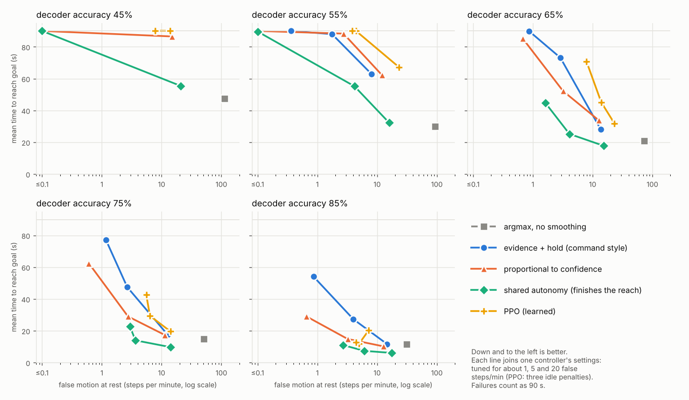

# Arm simulator: how the interpreter turns decoder output into arm motion

This compares ways of turning the decoder's rest/left/right output into arm motion, on a simulated 3-joint arm
with a scripted person (see `../sim/README.md`). Each interpreter is judged on two things: how long a reach takes, and
how far the arm wanders while the person only rests, measured in "false steps per minute" (one step = one standard
command). All numbers are simulation results at assumed per-window 3-class decoder accuracies. They are not
measurements of your system; map your decoder to the closest column, or replay its real output (`ReplayDecoder`).

## Findings

1. **Speed alone is the wrong score.** Plain argmax (move whenever a window says left/right) reaches the goal quickly
   (21 s at 65% accuracy) but wanders 72 false steps per minute while the person rests (31 at 85%, 113 at 45%).
   Smoothing, thresholds and hold times exist to stop that, and they cost speed. Compare controllers along the
   frontier in the figure, not by one number.
2. **Proportional-to-confidence beats command-style evidence at the same false-motion level, from 65% accuracy up.**
   At 75% accuracy and about 3 false steps/min: 29 s against 47 s. At 85% and about 1 false step/min: 29 s against 54 s.
   At 55% accuracy neither finishes reliably: even at 8-12 false steps/min they reach only about 75% of goals within 90 s.
3. **At about 1 false step per minute the ordinary interpreters need roughly 75% accuracy or better.** At 65% the
   evidence controller finishes 1% of reaches and the proportional one 22%; at 75% they finish 71% and 87%; at 85% both
   finish everything (54 s and 29 s). This is the same direction as the desktop's live-command result (about 1 false
   command/min but only 23% hits), though the two are not directly comparable.
4. **Shared autonomy (the arm finishes the reach once the goal is clear) is the fastest at every accuracy**, and the only
   interpreter that works at 1 false step/min with a 65% decoder (89% of reaches, 45 s; 100% and 25 s at 5/min). The costs:
   it needs the candidate goals to be known (4 assumed here); about 1 in 10 auto-reaches heads for the wrong goal at 65%
   (1 in 5 at 45%) and the person has to correct it; and its false motion at rest comes as rare large jumps, which the
   average steps/min understates.
5. **PPO did not beat the hand-tuned interpreters.** At 85% it lands in the same range as proportional (11-26 s at 2-12 false
   steps/min across settings and seeds); at 65-75% it is no faster than proportional at similar false motion; at 55% and below it mostly
   fails to learn. Seeds differ a lot (65% accuracy, penalty 160: one seed reaches 74% of goals, the other 0%). With only 400k
   training steps, 2 seeds and no hyperparameter search this is "no evidence it helps here", not "it cannot".
6. **Calibration matters more than the choice of controller.** Thresholds tuned on calibrated probabilities collapse when the
   decoder is under-confident: at temperature 2, evidence and proportional reach 0% of goals and shared autonomy 11%.
   Over-confident output (temperature 0.5) is fast but moves about 4-5 times more at rest (proportional: 13.6 against 2.8
   false steps/min; shared autonomy: 18.4 against 3.8). Check calibration, or retune thresholds, per person and per session before using confidence as speed.
7. **Slower user feedback hurts the command-style controllers; jaw detection quality barely matters.** Going from no delay
   to 1 s (4 decisions) in the user's view of the arm cuts evidence from 89% to 53% of goals reached and proportional from
   94% to 78%; shared autonomy stays at 99-100%. A jaw-clench detection rate anywhere from 70% to 98% changes little.

## Results by decoder accuracy

### Decoder accuracy 45%

| controller | tuned for (false steps/min) | reached goal | time to goal, s (95% CI; failures = 90 s) | measured false steps/min | wrong-way share of moves | auto-reaches (wrong) |
|---|---|---|---|---|---|---|
| argmax, no smoothing | n/a | 86% | 47.5 ± 3.0 | 112.7 | 34% | 0 |
| evidence + hold (command style) | 1 | 0% | 90.0 ± 0.0 | 0.1 | 3% | n/a |
| evidence + hold (command style) | 5 | 0% | 90.0 ± 0.0 | 0.1 | 3% | n/a |
| evidence + hold (command style) | 20 | 0% | 90.0 ± 0.0 | 0.1 | 3% | n/a |
| proportional to confidence | 1 | 0% | 90.0 ± 0.0 | 0.0 | 1% | n/a |
| proportional to confidence | 5 | 0% | 90.0 ± 0.0 | 0.0 | 1% | n/a |
| proportional to confidence | 20 | 16% | 86.5 ± 1.1 | 14.9 | 33% | n/a |
| shared autonomy (finishes the reach) | 1 | 0% | 90.0 ± 0.0 | 0.0 | 1% | 0.0 (0.0) |
| shared autonomy (finishes the reach) | 5 | 0% | 90.0 ± 0.0 | 0.0 | 1% | 0.0 (0.0) |
| shared autonomy (finishes the reach) | 20 | 71% | 55.4 ± 3.3 | 20.9 | 28% | 0.9 (0.2) |
| PPO (penalty 10, 2 seeds) | n/a | 0% | 90.0 ± 0.0 (sd over seeds) | 7.8 | 10% | n/a |
| PPO (penalty 40, 2 seeds) | n/a | 0% | 90.0 ± 0.0 (sd over seeds) | 14.1 | 9% | n/a |
| PPO (penalty 160, 2 seeds) | n/a | 0% | 90.0 ± 0.0 (sd over seeds) | 13.8 | 3% | n/a |

### Decoder accuracy 55%

| controller | tuned for (false steps/min) | reached goal | time to goal, s (95% CI; failures = 90 s) | measured false steps/min | wrong-way share of moves | auto-reaches (wrong) |
|---|---|---|---|---|---|---|
| argmax, no smoothing | n/a | 100% | 29.9 ± 1.9 | 92.9 | 29% | 0 |
| evidence + hold (command style) | 1 | 0% | 90.0 ± 0.0 | 0.4 | 6% | n/a |
| evidence + hold (command style) | 5 | 11% | 88.0 ± 0.8 | 1.8 | 10% | n/a |
| evidence + hold (command style) | 20 | 75% | 63.0 ± 2.7 | 8.0 | 16% | n/a |
| proportional to confidence | 1 | 0% | 90.0 ± 0.0 | 0.0 | 1% | n/a |
| proportional to confidence | 5 | 10% | 88.3 ± 0.7 | 2.7 | 13% | n/a |
| proportional to confidence | 20 | 77% | 62.2 ± 2.6 | 12.1 | 20% | n/a |
| shared autonomy (finishes the reach) | 1 | 2% | 89.6 ± 0.3 | 0.0 | 1% | 0.0 (0.0) |
| shared autonomy (finishes the reach) | 5 | 77% | 55.2 ± 3.2 | 4.2 | 11% | 0.9 (0.1) |
| shared autonomy (finishes the reach) | 20 | 95% | 32.3 ± 2.7 | 15.9 | 15% | 1.1 (0.1) |
| PPO (penalty 10, 2 seeds) | n/a | 50% | 67.2 ± 0.8 (sd over seeds) | 23.2 | 29% | n/a |
| PPO (penalty 40, 2 seeds) | n/a | 0% | 90.0 ± 0.0 (sd over seeds) | 4.4 | 15% | n/a |
| PPO (penalty 160, 2 seeds) | n/a | 0% | 90.0 ± 0.0 (sd over seeds) | 3.8 | 15% | n/a |

### Decoder accuracy 65%

| controller | tuned for (false steps/min) | reached goal | time to goal, s (95% CI; failures = 90 s) | measured false steps/min | wrong-way share of moves | auto-reaches (wrong) |
|---|---|---|---|---|---|---|
| argmax, no smoothing | n/a | 100% | 21.0 ± 1.2 | 72.4 | 24% | 0 |
| evidence + hold (command style) | 1 | 1% | 89.9 ± 0.1 | 0.9 | 5% | n/a |
| evidence + hold (command style) | 5 | 67% | 73.2 ± 2.0 | 2.9 | 9% | n/a |
| evidence + hold (command style) | 20 | 100% | 28.2 ± 1.5 | 13.6 | 13% | n/a |
| proportional to confidence | 1 | 22% | 85.1 ± 1.3 | 0.7 | 4% | n/a |
| proportional to confidence | 5 | 90% | 52.2 ± 2.6 | 3.2 | 10% | n/a |
| proportional to confidence | 20 | 99% | 33.8 ± 1.6 | 12.7 | 15% | n/a |
| shared autonomy (finishes the reach) | 1 | 89% | 44.6 ± 3.0 | 1.6 | 3% | 0.9 (0.1) |
| shared autonomy (finishes the reach) | 5 | 100% | 25.2 ± 2.1 | 4.1 | 7% | 1.1 (0.1) |
| shared autonomy (finishes the reach) | 20 | 100% | 17.7 ± 1.2 | 15.4 | 13% | 1.0 (0.0) |
| PPO (penalty 10, 2 seeds) | n/a | 98% | 31.7 ± 2.2 (sd over seeds) | 23.3 | 22% | n/a |
| PPO (penalty 40, 2 seeds) | n/a | 85% | 45.1 ± 5.7 (sd over seeds) | 13.9 | 26% | n/a |
| PPO (penalty 160, 2 seeds) | n/a | 37% | 70.7 ± 19.3 (sd over seeds) | 7.9 | 22% | n/a |

### Decoder accuracy 75%

| controller | tuned for (false steps/min) | reached goal | time to goal, s (95% CI; failures = 90 s) | measured false steps/min | wrong-way share of moves | auto-reaches (wrong) |
|---|---|---|---|---|---|---|
| argmax, no smoothing | n/a | 100% | 15.0 ± 0.7 | 51.2 | 17% | 0 |
| evidence + hold (command style) | 1 | 71% | 77.0 ± 1.4 | 1.2 | 3% | n/a |
| evidence + hold (command style) | 5 | 100% | 47.5 ± 1.6 | 2.7 | 6% | n/a |
| evidence + hold (command style) | 20 | 100% | 17.7 ± 0.8 | 12.5 | 10% | n/a |
| proportional to confidence | 1 | 87% | 62.5 ± 2.1 | 0.6 | 2% | n/a |
| proportional to confidence | 5 | 100% | 29.0 ± 1.3 | 2.7 | 6% | n/a |
| proportional to confidence | 20 | 100% | 17.4 ± 0.9 | 11.2 | 14% | n/a |
| shared autonomy (finishes the reach) | 1 | 100% | 22.6 ± 1.7 | 3.0 | 2% | 1.0 (0.0) |
| shared autonomy (finishes the reach) | 5 | 100% | 14.0 ± 0.9 | 3.7 | 5% | 1.0 (0.0) |
| shared autonomy (finishes the reach) | 20 | 100% | 9.8 ± 0.7 | 14.0 | 10% | 1.1 (0.1) |
| PPO (penalty 10, 2 seeds) | n/a | 100% | 19.6 ± 1.5 (sd over seeds) | 14.0 | 23% | n/a |
| PPO (penalty 40, 2 seeds) | n/a | 91% | 29.4 ± 8.0 (sd over seeds) | 6.4 | 16% | n/a |
| PPO (penalty 160, 2 seeds) | n/a | 73% | 42.7 ± 15.3 (sd over seeds) | 5.5 | 20% | n/a |

### Decoder accuracy 85%

| controller | tuned for (false steps/min) | reached goal | time to goal, s (95% CI; failures = 90 s) | measured false steps/min | wrong-way share of moves | auto-reaches (wrong) |
|---|---|---|---|---|---|---|
| argmax, no smoothing | n/a | 100% | 11.5 ± 0.4 | 31.1 | 10% | 0 |
| evidence + hold (command style) | 1 | 100% | 54.1 ± 1.1 | 0.9 | 2% | n/a |
| evidence + hold (command style) | 5 | 100% | 27.3 ± 0.7 | 4.0 | 5% | n/a |
| evidence + hold (command style) | 20 | 100% | 11.6 ± 0.4 | 14.7 | 10% | n/a |
| proportional to confidence | 1 | 100% | 29.0 ± 1.0 | 0.7 | 1% | n/a |
| proportional to confidence | 5 | 100% | 14.9 ± 0.6 | 3.2 | 5% | n/a |
| proportional to confidence | 20 | 100% | 10.2 ± 0.4 | 12.8 | 9% | n/a |
| shared autonomy (finishes the reach) | 1 | 100% | 11.1 ± 0.8 | 2.7 | 1% | 1.0 (0.0) |
| shared autonomy (finishes the reach) | 5 | 100% | 7.4 ± 0.5 | 6.1 | 4% | 1.0 (0.0) |
| shared autonomy (finishes the reach) | 20 | 100% | 6.1 ± 0.4 | 17.5 | 8% | 1.0 (0.0) |
| PPO (penalty 10, 2 seeds) | n/a | 100% | 11.7 ± 0.4 (sd over seeds) | 5.0 | 13% | n/a |
| PPO (penalty 40, 2 seeds) | n/a | 100% | 12.8 ± 1.8 (sd over seeds) | 4.4 | 15% | n/a |
| PPO (penalty 160, 2 seeds) | n/a | 97% | 20.4 ± 5.3 (sd over seeds) | 7.3 | 22% | n/a |

## Sensitivity

Parameters were tuned at 65% accuracy and the 5 false steps/min budget, then the world was changed without retuning.
Each cell is reached goal / time to goal (s) / false steps per minute.

**Decoder confidence (1 = calibrated; <1 over-confident, >1 under-confident)**

| controller | temperature = 0.5 | temperature = 1.0 | temperature = 2.0 |
|---|---|---|---|
| argmax, no smoothing | 100% / 21 / 68.4 | 100% / 21 / 68.4 | 100% / 21 / 68.4 |
| evidence + hold (command style) | 95% / 51 / 10.3 | 67% / 72 / 2.8 | 0% / 90 / 0.0 |
| proportional to confidence | 100% / 27 / 13.6 | 89% / 52 / 2.8 | 0% / 90 / 0.0 |
| shared autonomy (finishes the reach) | 100% / 15 / 18.4 | 99% / 25 / 3.8 | 11% / 85 / 0.0 |

**Correlation between successive decoder windows**

| controller | rho = 0.5 | rho = 0.85 | rho = 0.95 |
|---|---|---|---|
| argmax, no smoothing | 100% / 17 / 78.4 | 100% / 21 / 68.4 | 99% / 24 / 53.1 |
| evidence + hold (command style) | 49% / 82 / 0.2 | 67% / 72 / 2.8 | 37% / 79 / 4.7 |
| proportional to confidence | 57% / 79 / 0.0 | 89% / 52 / 2.8 | 71% / 60 / 5.8 |
| shared autonomy (finishes the reach) | 99% / 34 / 0.0 | 99% / 25 / 3.8 | 94% / 30 / 9.2 |

**User's view of the arm is late by this many decisions (0.25 s each)**

| controller | delay = 0 | delay = 2 | delay = 4 |
|---|---|---|---|
| argmax, no smoothing | 100% / 19 / 68.4 | 100% / 21 / 68.4 | 100% / 24 / 68.4 |
| evidence + hold (command style) | 89% / 60 / 2.8 | 67% / 72 / 2.8 | 53% / 78 / 2.8 |
| proportional to confidence | 94% / 47 / 2.8 | 89% / 52 / 2.8 | 78% / 59 / 2.8 |
| shared autonomy (finishes the reach) | 100% / 23 / 3.8 | 99% / 25 / 3.8 | 99% / 25 / 3.8 |

**Chance an intended jaw clench is detected**

| controller | jaw_hit = 0.7 | jaw_hit = 0.9 | jaw_hit = 0.98 |
|---|---|---|---|
| argmax, no smoothing | 100% / 22 / 68.4 | 100% / 21 / 68.4 | 100% / 20 / 68.4 |
| evidence + hold (command style) | 67% / 73 / 2.8 | 67% / 72 / 2.8 | 66% / 74 / 2.8 |
| proportional to confidence | 89% / 55 / 2.8 | 89% / 52 / 2.8 | 91% / 51 / 2.8 |
| shared autonomy (finishes the reach) | 99% / 26 / 3.8 | 99% / 25 / 3.8 | 99% / 24 / 3.8 |

## What this does and does not tell you

- **The person is a script.** They always imagine the right command, anticipate the arm's motion and never get tired. Real
  users adapt to the controller and to feedback (better or worse), which only real sessions can show.
- **The decoder is a model.** Gaussian logits, successive windows correlated at 0.85, probabilities calibrated unless
  stated. Real decoders have person-specific error patterns (the desktop reports 3 of 9 people at 38-64% live hits),
  session drift and uncalibrated confidence. `ReplayDecoder` exists to use real output instead; none was available here.
- **Accuracy columns are per-window 3-class accuracy (rest/left/right).** The desktop's 70% left/right and 52% 4-class are
  different class sets, so the mapping to a column is approximate.
- **The arm is three joints in normalised units** with instant response, placeholder geometry and no serial protocol.
- **The evidence controller is a model of the command layer described in the desktop README** (smoothing + threshold +
  hold + refractory), not that code, which also tunes per person and may do better than this grid search.
- **Budgets are tuning targets, not guarantees.** Settings are picked on tuning seeds and measured on fresh ones, so the
  measured false steps/min can differ from the "tuned for" label. Compare on the frontier.
- **PPO was given a modest budget** (400k steps, 2 seeds per cell, one network size, no tuning). One goal set of 4 targets.

## Settings

| setting | value |
|---|---|
| dt | 0.25 |
| q_limit | 1.0 |
| tol | 0.06 |
| dwell | 2 |
| step | 0.05 |
| max_dq | 0.1 |
| t_max | 90.0 |
| delay | 2 |
| anticipate | True |
| switch_refractory | 2 |
| jaw_hit | 0.9 |
| jaw_false_per_min | 0.3 |
| rho | 0.85 |
| temperature | 1.0 |

Goals: 4 fixed joint-space targets (`armsim/config.py`). Reach episodes: 300 per cell (fresh seeds, never used for tuning); idle test: 40 two-minute runs per cell.

## Tuned parameters

| accuracy | controller | tuned for (false steps/min) | parameters |
|---|---|---|---|
| 45% | evidence | 1 | alpha=0.8, theta=0.7, hold=1, refractory=0 |
| 45% | evidence | 5 | alpha=0.8, theta=0.7, hold=1, refractory=0 |
| 45% | evidence | 20 | alpha=0.8, theta=0.7, hold=1, refractory=0 |
| 45% | proportional | 1 | alpha=0.3, theta=0.5, gamma=2, vmax=0.2, hold=1 |
| 45% | proportional | 5 | alpha=0.3, theta=0.5, gamma=2, vmax=0.2, hold=1 |
| 45% | proportional | 20 | alpha=0.7, theta=0.4, gamma=1, vmax=0.4, hold=2 |
| 45% | shared | 1 | alpha=0.3, theta=0.5, gamma=2, vmax=0.2, hold=1, kappa=0.15, tau=0.8 |
| 45% | shared | 5 | alpha=0.3, theta=0.5, gamma=2, vmax=0.2, hold=1, kappa=0.15, tau=0.8 |
| 45% | shared | 20 | alpha=0.7, theta=0.4, gamma=1, vmax=0.4, hold=2, kappa=0.3, tau=0.8 |
| 55% | evidence | 1 | alpha=0.3, theta=0.7, hold=3, refractory=2 |
| 55% | evidence | 5 | alpha=0.3, theta=0.7, hold=1, refractory=0 |
| 55% | evidence | 20 | alpha=0.3, theta=0.6, hold=1, refractory=0 |
| 55% | proportional | 1 | alpha=0.3, theta=0.7, gamma=2, vmax=0.2, hold=1 |
| 55% | proportional | 5 | alpha=0.7, theta=0.7, gamma=0.5, vmax=0.3, hold=1 |
| 55% | proportional | 20 | alpha=0.7, theta=0.6, gamma=0.5, vmax=0.4, hold=1 |
| 55% | shared | 1 | alpha=0.3, theta=0.7, gamma=2, vmax=0.2, hold=1, kappa=0.6, tau=0.8 |
| 55% | shared | 5 | alpha=0.7, theta=0.7, gamma=0.5, vmax=0.3, hold=1, kappa=0.3, tau=0.8 |
| 55% | shared | 20 | alpha=0.7, theta=0.6, gamma=0.5, vmax=0.4, hold=1, kappa=0.6, tau=0.97 |
| 65% | evidence | 1 | alpha=0.3, theta=0.7, hold=3, refractory=3 |
| 65% | evidence | 5 | alpha=0.3, theta=0.7, hold=1, refractory=1 |
| 65% | evidence | 20 | alpha=0.3, theta=0.6, hold=1, refractory=0 |
| 65% | proportional | 1 | alpha=0.3, theta=0.7, gamma=2, vmax=0.4, hold=2 |
| 65% | proportional | 5 | alpha=0.3, theta=0.7, gamma=0.5, vmax=0.4, hold=2 |
| 65% | proportional | 20 | alpha=0.3, theta=0.5, gamma=0.5, vmax=0.2, hold=2 |
| 65% | shared | 1 | alpha=0.3, theta=0.7, gamma=2, vmax=0.4, hold=2, kappa=0.3, tau=0.8 |
| 65% | shared | 5 | alpha=0.3, theta=0.7, gamma=0.5, vmax=0.4, hold=2, kappa=0.3, tau=0.8 |
| 65% | shared | 20 | alpha=0.3, theta=0.5, gamma=0.5, vmax=0.2, hold=2, kappa=0.15, tau=0.8 |
| 75% | evidence | 1 | alpha=0.3, theta=0.7, hold=3, refractory=2 |
| 75% | evidence | 5 | alpha=0.3, theta=0.7, hold=2, refractory=0 |
| 75% | evidence | 20 | alpha=0.3, theta=0.6, hold=1, refractory=0 |
| 75% | proportional | 1 | alpha=0.3, theta=0.7, gamma=2, vmax=0.2, hold=2 |
| 75% | proportional | 5 | alpha=0.3, theta=0.7, gamma=1, vmax=0.4, hold=2 |
| 75% | proportional | 20 | alpha=0.3, theta=0.6, gamma=0.5, vmax=0.4, hold=1 |
| 75% | shared | 1 | alpha=0.3, theta=0.7, gamma=2, vmax=0.2, hold=2, kappa=0.3, tau=0.8 |
| 75% | shared | 5 | alpha=0.3, theta=0.7, gamma=1, vmax=0.4, hold=2, kappa=0.3, tau=0.9 |
| 75% | shared | 20 | alpha=0.3, theta=0.6, gamma=0.5, vmax=0.4, hold=1, kappa=0.3, tau=0.9 |
| 85% | evidence | 1 | alpha=0.3, theta=0.7, hold=3, refractory=2 |
| 85% | evidence | 5 | alpha=0.3, theta=0.6, hold=2, refractory=0 |
| 85% | evidence | 20 | alpha=0.3, theta=0.5, hold=1, refractory=0 |
| 85% | proportional | 1 | alpha=0.3, theta=0.7, gamma=2, vmax=0.2, hold=2 |
| 85% | proportional | 5 | alpha=0.3, theta=0.7, gamma=0.5, vmax=0.3, hold=1 |
| 85% | proportional | 20 | alpha=0.5, theta=0.6, gamma=0.5, vmax=0.4, hold=1 |
| 85% | shared | 1 | alpha=0.3, theta=0.7, gamma=2, vmax=0.2, hold=2, kappa=0.3, tau=0.8 |
| 85% | shared | 5 | alpha=0.3, theta=0.7, gamma=0.5, vmax=0.3, hold=1, kappa=0.6, tau=0.97 |
| 85% | shared | 20 | alpha=0.5, theta=0.6, gamma=0.5, vmax=0.4, hold=1, kappa=0.6, tau=0.97 |